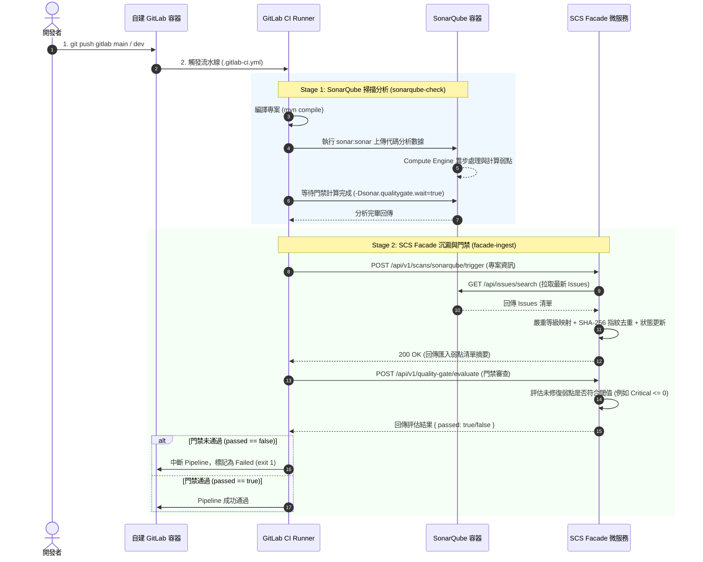

# GitLab CI、SonarQube 與 SCS Facade 整合架構設計 (CI/CD Integration Architecture)

## 1. 簡介與核心願景 (Overview & Objectives)

本架構規範旨在為 **SCS Facade (源碼掃描門面服務)** 建立完整的 DevSecOps 自動化閉環，並落實「**以戰養戰 (Dogfooding / 自給自足)**」理念：
透過將 `scs-facade` 本身（或受管之業務微服務專案）推送到**自建 GitLab 容器**，由 **GitLab CI** 自動觸發 **SonarQube** 靜態代碼分析，並在掃描完成後自動將弱點資訊同步記錄至 **SCS Facade** 進行標準化資料沉澱、指紋去重及 CI/CD 品質門禁（Quality Gate）審查。

---

## 2. 系統架構拓撲與資料流 (System Topology & Data Flow)

### 2.1 容器拓撲架構圖

```mermaid
flowchart TD
    subgraph Host [開發者主機 / 宿主機 (Host Machine)]
        Dev[開發者 Workstation\ngit push]
        FacadeApp[SCS Facade 微服務\nSpring Boot (Port 8080)]
        FacadeDB[(Facade 資料庫\nH2 / PostgreSQL)]
        FacadeApp --> FacadeDB
    end

    subgraph DockerNet [Docker 自建容器網絡 (devsecops-net)]
        GitLab[GitLab CE/EE 容器\nPort 80 / 443]
        Runner[GitLab CI Runner 容器\nDocker Executor]
        SonarQube[SonarQube 容器\nPort 9000]
    end

    Dev -- "git push gitlab main" --> GitLab
    GitLab -- "調度 Job" --> Runner
    Runner -- "1. mvn verify sonar:sonar" --> SonarQube
    Runner -- "2. POST /api/v1/scans/sonarqube/trigger\n(host.docker.internal:8080)" --> FacadeApp
    Runner -- "3. POST /api/v1/quality-gate/evaluate\n門禁阻擋審查" --> FacadeApp
    FacadeApp -- "REST API: 拉取 Issues 清單" --> SonarQube
```

### 2.2 端到端時序圖 (End-to-End Sequence Diagram)



---

## 3. GitLab CI 流水線設計 (`.gitlab-ci.yml`)

將專案根目錄之 [.gitlab-ci.yml](file:///d:/桌面/VibeCodingWorkSpace/scs-facade/.gitlab-ci.yml) 規劃為兩階段：

```yaml
stages:
  - sonarqube-check
  - facade-ingest

# ==========================================
# 階段一：SonarQube 源碼掃描分析
# ==========================================
sonarqube-analysis:
  stage: sonarqube-check
  image: maven:3.9-eclipse-temurin-21
  variables:
    SONAR_USER_HOME: "${CI_PROJECT_DIR}/.sonar"
    GIT_DEPTH: "0"
    MAVEN_OPTS: "-Dmaven.repo.local=.m2/repository"
  cache:
    key: "${CI_COMMIT_REF_SLUG}"
    paths:
      - .sonar/cache
      - .m2/repository
  script:
    - >-
      mvn clean verify sonar:sonar
      -Dsonar.host.url="${SONAR_HOST_URL}"
      -Dsonar.token="${SONAR_TOKEN}"
      -Dsonar.projectKey="${CI_PROJECT_NAME}"
      -Dsonar.projectName="${CI_PROJECT_TITLE}"
      -Dsonar.qualitygate.wait=true
  allow_failure: false
  only:
    - main
    - dev

# ==========================================
# 階段二：SCS Facade 弱點資料匯入與門禁審查
# ==========================================
scs-facade-sync:
  stage: facade-ingest
  image: curlimages/curl:latest
  variables:
    # 宿主機 Facade 服務位址 (依環境調整)
    FACADE_HOST_URL: "http://host.docker.internal:8080"
  script:
    - echo "=== 1. 通知 SCS Facade 匯入 SonarQube 掃描結果 ==="
    - >-
      curl -s -f -X POST "${FACADE_HOST_URL}/api/v1/scans/sonarqube/trigger"
      -H "Content-Type: application/json"
      -d "{
        \"projectId\": \"${CI_PROJECT_NAME}\",
        \"branch\": \"${CI_COMMIT_REF_NAME}\",
        \"commitHash\": \"${CI_COMMIT_SHA}\"
      }"

    - echo "=== 2. 呼叫 SCS Facade 執行統一門禁審查 ==="
    - >-
      RESPONSE=$(curl -s -X POST "${FACADE_HOST_URL}/api/v1/quality-gate/evaluate"
        -H "Content-Type: application/json"
        -d "{
          \"projectId\": \"${CI_PROJECT_NAME}\",
          \"maxCritical\": 0,
          \"maxHigh\": 2,
          \"blockOnSecrets\": true
        }")
    - echo "門禁審查回應: ${RESPONSE}"
    - >-
      PASSED=$(echo "${RESPONSE}" | grep -o '"passed":true' || true)
    - |
      if [ -z "${PASSED}" ]; then
        echo "❌ 品質門禁檢查未通過！發現超出允許範圍的嚴重弱點。"
        exit 1
      else
        echo "✅ 品質門禁檢查順利通過！"
      fi
  only:
    - main
    - dev
```

---

## 4. GitLab CI 環境變數設定清單 (CI/CD Variables)

在自建 GitLab 的專案設定中 (**Settings -> CI/CD -> Variables**)，配置以下變數：

| 變數名稱 | 範例值 | 說明 | Masked |
| :--- | :--- | :--- | :---: |
| `SONAR_HOST_URL` | `http://sonarqube:9000` 或 `http://host.docker.internal:9000` | SonarQube 服務位址 | 否 |
| `SONAR_TOKEN` | `sqa_xxxxxxxxxxxxxxxxxxxx` | SonarQube 後台產生之分析權限 Token | **是** |
| `FACADE_HOST_URL`| `http://host.docker.internal:8080` | SCS Facade API 服務位址 | 否 |

---

## 5. 容器環境網路通訊避坑指南 (Container Networking Best Practices)

由於 GitLab、Runner、SonarQube 與 Facade 可能混合運行於容器及宿主機環境，需特別注意 Docker 網路互通機制：

### 5.1 「Localhost」之誤區
* **容器內部**：在 Docker 容器內發送請求至 `localhost`，只會連到該容器自己，無法連到宿主機或其他容器。
* **連向宿主機 (Host Machine)**：
  * 在 Windows / macOS Docker Desktop 環境中，容器連向宿主機請使用網域名稱：
    ```
    http://host.docker.internal:8080
    ```
  * 在 Linux 原生 Docker 環境中，Runner 容器需在啟動時加上 `--add-host=host.docker.internal:host-gateway`。

### 5.2 建立專屬 Docker 內部網路 (推薦)
建議為所有相關基礎設施容器建立共用 Network，容器間直接以「服務名稱」通訊：
```bash
# 1. 建立共用網路
docker network create devsecops-net

# 2. 將 GitLab、SonarQube、Runner 連入同一網路
docker network connect devsecops-net gitlab
docker network connect devsecops-net sonarqube
docker network connect devsecops-net gitlab-runner
```
此時 Runner 即可直接透過 `http://sonarqube:9000` 存取 SonarQube。

### 5.3 SonarQube 分析時間差處理
SonarQube 伺服器在接收掃描資料後，需透過 Compute Engine (CE) 非同步建立索引與弱點記錄：
* **關鍵參數**：在 Maven 執行時必須加上：
  ```properties
  -Dsonar.qualitygate.wait=true
  ```
  這能強制 GitLab Runner 等待 SonarQube 伺服器端完成運算後再進入下一個 Stage，避免 Facade 在資料尚未寫入完成時拉取到舊數據。

---

## 6. SCS Facade 端點規格對照

本架構中由 GitLab CI 呼叫之 Facade 端點：

| HTTP 方法 | 路徑 | 請求載體 (Request) | 回應載體 (Response) | 業務職責 |
| :--- | :--- | :--- | :--- | :--- |
| `POST` | `/api/v1/scans/sonarqube/trigger` | `IngestSonarQubeResource` | `SonarQubeIngestedResource` | 通知 Facade 拉取 SonarQube 報告並指紋去重入庫 |
| `POST` | `/api/v1/quality-gate/evaluate` | `EvaluateQualityGateResource` | `QualityGateEvaluatedResource` | 審查當前專案弱點是否違反門禁規則 (回傳 passed 狀態) |
| `GET` | `/api/v1/findings` | 查詢參數 `projectId`, `status` | `List<FindingGottenView>` | 查詢專案目前所有弱點視圖 |

---

## 7. 多遠端儲存庫配置 (同時屬於 GitLab 與 GitHub)

若希望本專案同時向自建 GitLab 容器與 GitHub 進行版本控制：

### 7.1 本地配置雙 Remote (獨立推送)
```bash
# 初始化並添加遠端
git init
git remote add gitlab http://<gitlab-ip>/root/scs-facade.git
git remote add github git@github.com:<username>/scs-facade.git

# 推送至 GitLab (觸發自建 CI 與 SonarQube 掃描)
git push gitlab main

# 推送至 GitHub (公開/備份/協作)
git push github main
```

### 7.2 單一指令雙向推送 (Dual Push)
```bash
git remote set-url --add --push origin http://<gitlab-ip>/root/scs-facade.git
git remote set-url --add --push origin git@github.com:<username>/scs-facade.git

# 一次指令同步推送到兩個平台
git push origin main
```
