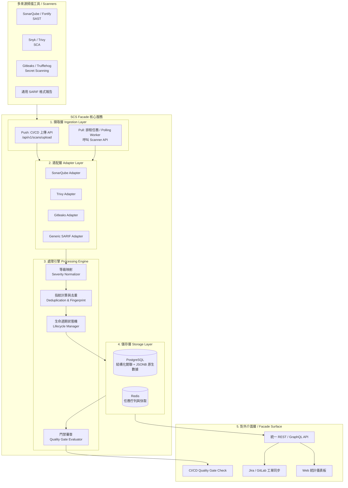

# 源碼掃描結果整合門面 (Source Code Scan Facade) 設計與實作指南

## 1. 簡介與核心定位 (Overview & Objective)

在現代 DevSecOps 流程中，企業通常會引入多種不同領域的安全與程式碼品質檢測工具（SAST、SCA、Secret Scanning、IaC 等）。然而，各掃描工具存在以下痛點：
- **格式碎片化**：不同工具產生的報告格式各異（JSON、XML、CSV、HTML 或專有格式）。
- **嚴重等級不一致**：各家工具對 Critical / High / Medium / Blocker / Major 等定義與閾值不同。
- **重複與噪音 (Noise & Duplicates)**：不同工具重複掃描出相同的問題，增加資安團隊與開發者的分類（Triage）成本。
- **門禁難以統一管理**：CI/CD Pipeline 需呼叫多個不同的 CLI 或 API 才能做出是否放行的決策。

**SCS Facade（源碼掃描門面服務）** 的核心目標是建立一個中介層服務，提供：
1. **統一介接與標準化 (Unified Ingestion & Normalization)**：適配異質掃描工具，轉換為標準弱點模型。
2. **去重與生命週期追蹤 (Deduplication & Lifecycle Tracking)**：計算漏洞指紋，追蹤新發現、既有與已修復漏洞。
3. **統一品質門禁 (Quality Gate)**：在 CI/CD 中提供單一決策端點，自動評估專案是否合規。
4. **外部系統連動 (Integrations)**：與 Jira、GitLab、Slack 等通知及工單系統無縫串接。

---

## 2. 系統架構設計 (System Architecture)

採用 **Facade Pattern（門面模式）** 搭配 **Adapter / Strategy Pattern（適配器 / 策略模式）** 進行解耦：



---

## 3. 資料模型標準化 (Canonical Finding Model)

建議基於國際標準 **OASIS SARIF (Static Analysis Results Interchange Format)** 提煉出輕量且高查詢效能的 Canonical Finding Schema：

### 3.1 核心資料欄位規格

```json
{
  "finding_id": "9b1deb4d-3b7d-4bad-9bdd-2b0d7b3dcb6d",
  "fingerprint": "a3f5b7218e90c128ef3c89b33a2e7c1182740bc1d283749021d7b384a83921f0",
  "project_id": "payment-gateway",
  "branch": "main",
  "commit_hash": "7f8b92c",
  "tool": {
    "name": "SonarQube",
    "version": "10.4",
    "category": "SAST" 
  },
  "rule": {
    "id": "java:S2077",
    "name": "SQL queries should not be vulnerable to injection attacks",
    "cwe": ["CWE-89"],
    "cve": null
  },
  "severity": "CRITICAL",
  "location": {
    "file_path": "src/main/java/com/example/OrderService.java",
    "start_line": 42,
    "end_line": 45,
    "snippet": "String sql = \"SELECT * FROM orders WHERE id = '\" + orderId + \"'\";"
  },
  "status": "OPEN",
  "first_seen_at": "2026-10-10T08:30:00Z",
  "last_seen_at": "2026-10-11T12:00:00Z",
  "raw_details": {
    "debt": "30min",
    "effort": "30min",
    "key": "AX3j1kL89_original_key"
  }
}
```

### 3.2 欄位說明
- **`tool.category`**：分類標籤，支援 `SAST`、`SCA`、`SECRET`、`IAC`、`CONTAINER`。
- **`severity`**：標準化嚴重等級，固定為 `CRITICAL`、`HIGH`、`MEDIUM`、`LOW`、`INFO` 五種。
- **`status`**：生命週期狀態，包含：
  - `OPEN`：新發現或持續存在的弱點。
  - `CONFIRMED`：人工審核確認之真實弱點。
  - `FALSE_POSITIVE`：標記為誤報。
  - `ACCEPTED_RISK`：接受風險（短期不修復）。
  - `RESOLVED`：已修復（在最新一輪掃描中消失）。
- **`raw_details`**：以 JSONB 保留原始工具回傳之完整 Payload，避免資訊遺失。

---

## 4. 嚴重等級標準化矩陣 (Severity Normalization)

各掃描工具的嚴重程度等級需對齊至標準的五級分類：

| 標準等級 (Canonical) | SonarQube | Fortify SSC | Snyk / Trivy | Checkmarx | CVSS v3 分數區間 |
| :--- | :--- | :--- | :--- | :--- | :--- |
| **CRITICAL** | Blocker | Critical | Critical | High (CVSS >= 9) | 9.0 ~ 10.0 |
| **HIGH** | Critical | High | High | High | 7.0 ~ 8.9 |
| **MEDIUM** | Major | Medium | Medium | Medium | 4.0 ~ 6.9 |
| **LOW** | Minor | Low | Low | Low | 0.1 ~ 3.9 |
| **INFO** | Info | Info | None / Low | Informational | 0.0 |

---

## 5. 去重與指紋計算策略 (Deduplication & Fingerprint)

### 5.1 為什麼需要指紋？
- **跨掃描輪次追蹤**：開發者新增或刪除了其他行代碼，導致行號位移時，不能將同一個漏洞誤判為「舊漏洞已修復」加「新漏洞產生」。
- **跨工具去重**：不同工具（如 Semgrep 與 SonarQube）報告了同一個檔案同一行的同一個 CWE 弱點。

### 5.2 指紋生成演算法
1. **SAST 弱點指紋**：
   ```
   Fingerprint = SHA256( ProjectID + NormalizePath(FilePath) + RuleCWE + NormalizedContextCode )
   ```
   * *注意*：避免直接對絕對行號進行 Hash；應提取該行與周圍 2 行的程式碼並去除空白後做 Hash。
2. **SCA (套件依賴) 弱點指紋**：
   ```
   Fingerprint = SHA256( ProjectID + PackageName + Version + (CVE_ID || GHSA_ID) )
   ```
3. **Secret (金鑰洩漏) 弱點指紋**：
   ```
   Fingerprint = SHA256( ProjectID + NormalizePath(FilePath) + SHA256(SecretValue) )
   ```

---

## 6. 資料介接模式 (Ingestion Patterns)

系統支援兩種主要介接管道：

### 6.1 Push 模式 (CI/CD 驅動 - 推薦)
適用於 Trivy、Gitleaks、Semgrep 等 CLI 工具：
1. CI/CD 執行掃描並輸出 JSON / SARIF 檔案。
2. 呼叫 Facade 上傳端點：
   ```http
   POST /api/v1/scans/upload
   Content-Type: multipart/form-data

   Parameters:
     - project: payment-service
     - branch: feature/login
     - commit: a1b2c3d
     - tool: trivy
     - file: @trivy-results.json
   ```

### 6.2 Pull 模式 (主動排程抓取)
適用於集中託管伺服器的工具（如 SonarQube Server、Fortify SSC）：
1. Facade 內建排程背景 Worker (如 Celery 或 Cron)。
2. 透過設定檔中的 API Token 定期打入各工具 REST API：
   - SonarQube: `GET /api/issues/search?componentKeys={project}&resolved=false`
   - Snyk: `GET /v1/org/{orgId}/project/{projectId}/issues`
3. 取得最新增量數據並寫入 Facade。

---

## 7. CI/CD 品質門禁 (Quality Gate Evaluation)

在 CI/CD 中，提供單一統一檢核端點，避免 Pipeline 撰寫大量複雜判斷：

```http
POST /api/v1/quality-gate/evaluate
Content-Type: application/json

{
  "project": "payment-gateway",
  "branch": "main",
  "commit": "7f8b92c",
  "policy": {
    "max_critical": 0,
    "max_high": 2,
    "block_on_unreviewed_secret": true
  }
}
```

**回傳範例**：
```json
{
  "passed": false,
  "summary": {
    "critical_count": 1,
    "high_count": 3,
    "secrets_count": 0
  },
  "violating_findings": [
    {
      "finding_id": "9b1deb4d...",
      "rule": "CWE-89 SQL Injection",
      "severity": "CRITICAL",
      "file_path": "src/main/java/com/example/OrderService.java"
    }
  ],
  "reason": "Quality gate failed: 1 CRITICAL found (threshold: 0); 3 HIGH found (threshold: 2)."
}
```
*CI/CD 腳本只要根據 `passed` 狀態決定是否以 `exit 1` 中斷建置即可。*

---

## 8. 技術選型 (Tech Stack)

| 模組 | 選用技術 | 選型依據 |
| :--- | :--- | :--- |
| **程式語言與版本** | **Java 17 / 21+** | 現代企業級標準，強型別、高吞吐量、支援 Record 與 Pattern Matching。 |
| **微服務核心框架** | **Spring Boot 3.3.x+** | 現代化微服務標準，內建原生 `RestClient` 簡化 HTTP 呼叫，支援 AOT 與 Virtual Threads。 |
| **建置管理工具** | **Apache Maven** | 依賴管理與外掛插件生態系完備。 |
| **資料持久化** | **Spring Data JPA + PostgreSQL (開發階段支援 H2)** | 支援關聯查詢與 JSONB 結構化存儲；H2 提供開箱即用之單元/整合測試。 |
| **API 文件與規格** | **SpringDoc OpenAPI (Swagger UI)** | 提供互動式 API 測試與 CI/CD 介接規格說明。 |

---

## 9. DDD 領域驅動與六角形架構實踐 (遵循 AGENTS.md 規範)

本專案之程式碼結構嚴格遵守工作區之架構準則：

### 9.1 核心分層與目錄結構 (Package Structure)

```
com.example.scsfacade/
├── domain/                                     # 1. 領域層 (Pure Java, 零框架, 零 Lombok, 業務規則核心)
│   ├── finding/                                # 依 Aggregate (Finding) 垂直切片
│   │   ├── aggregate/
│   │   │   ├── root/Finding.java               # 聚合根 (行為封裝, 私有屬性, 禁止 Lombok)
│   │   │   └── vo/                             # 實質物件 (Value Objects)
│   │   │       ├── FindingId.java
│   │   │       ├── Severity.java
│   │   │       ├── FindingStatus.java
│   │   │       ├── FindingLocation.java
│   │   │       ├── RuleInfo.java
│   │   │       └── ScannerToolInfo.java
│   │   ├── event/                              # 領域事件 (N + Ved + Event)
│   │   │   ├── FindingIngestedEvent.java
│   │   │   └── FindingStatusChangedEvent.java
│   │   └── exception/                          # 領域專屬例外
│   │       └── FindingNotFoundException.java
│   └── qualitygate/                            # 依 Aggregate (QualityGate) 垂直切片
│       ├── aggregate/
│       │   ├── root/QualityGatePolicy.java
│       │   └── vo/
│       │       ├── QualityGateThreshold.java
│       │       └── QualityGateStatus.java
│       ├── event/
│       │   └── QualityGateEvaluatedEvent.java
│       └── exception/
│           └── QualityGatePolicyNotFoundException.java
│
├── application/                                # 2. 應用層 (CQRS 流程調度, 業務合約, 禁接技術類物件)
│   ├── port/
│   │   ├── in/                                 # Inbound Ports (Use Cases 業務合約)
│   │   │   ├── IngestSonarQubeUseCase.java
│   │   │   ├── EvaluateQualityGateUseCase.java
│   │   │   └── GetFindingUseCase.java
│   │   └── out/                                # Outbound Ports (外部設施合約)
│   │       ├── FindingRepositoryPort.java
│   │       ├── SonarQubeScannerPort.java
│   │       └── FindingEventPublisherPort.java
│   ├── command/                                # Commands (V + N + Command)
│   │   ├── IngestSonarQubeCommand.java
│   │   └── EvaluateQualityGateCommand.java
│   ├── query/                                  # Queries (V + N + Query)
│   │   ├── GetFindingQuery.java
│   │   └── ListFindingQuery.java
│   ├── dto/                                    # DTO 純資料載體 (N + Gotten/Searched + Result, 嚴禁轉換邏輯)
│   │   ├── FindingGottenResult.java
│   │   └── QualityGateEvaluatedResult.java
│   ├── view/                                   # View 純資料載體 (N + Gotten/Searched + View)
│   │   └── FindingGottenView.java
│   ├── assembler/                              # Assembler (負責 Domain <-> DTO/View 互相轉換)
│   │   ├── FindingDtoAssembler.java
│   │   └── QualityGateDtoAssembler.java
│   └── service/                                # UseCase 實作服務 (CommandService / QueryService)
│       ├── IngestSonarQubeCommandService.java
│       ├── EvaluateQualityGateCommandService.java
│       └── FindingQueryService.java
│
├── infrastructure/                             # 3. 基礎設施層 (Outbound Adapters, 外部系統與持久化)
│   ├── persistence/                            # 依 Aggregate 名稱分類
│   │   └── finding/
│   │       ├── entity/FindingJpaEntity.java    # ORM 實體 (可使用 Lombok, @Entity, @Table)
│   │       └── repository/FindingJpaRepository.java # Spring Data JPA Repository
│   ├── client/                                 # 外部第三方 API 客戶端
│   │   └── sonarqube/
│   │       ├── SonarQubeRestClient.java
│   │       └── dto/SonarQubeIssuesApiResponse.java
│   └── adapter/                                # 實作 application/port/out 的適配器
│       ├── FindingRepositoryAdapter.java
│       ├── SonarQubeScannerAdapter.java
│       └── FindingEventPublisherAdapter.java
│
├── presentation/                               # 4. 表現層 (Inbound Adapters, REST API)
│   ├── resource/
│   │   ├── in/                                 # 請求載體 (V + N + Resource, 純資料, 禁止 toCommand)
│   │   │   ├── IngestSonarQubeResource.java
│   │   │   └── EvaluateQualityGateResource.java
│   │   └── out/                                # 回應載體 (N + Ved + Resource, 純資料, 禁止 fromResult)
│   │       ├── SonarQubeIngestedResource.java
│   │       ├── QualityGateEvaluatedResource.java
│   │       └── FindingGottenResource.java
│   ├── assembler/                              # 表現層轉換器 (Resource <-> Command/Query/DTO)
│   │   ├── SonarQubeResourceAssembler.java
│   │   ├── QualityGateResourceAssembler.java
│   │   └── FindingResourceAssembler.java
│   └── controller/                             # REST 控制器 (呼叫 UseCase)
│       ├── SonarQubeWebhookController.java
│       ├── QualityGateController.java
│       └── FindingController.java
│
├── config/                                     # 5. 配置層 (The Dirtiest Layer, Spring 集中配置)
│   ├── SonarQubeProperties.java
│   ├── OpenApiConfiguration.java
│   └── WebMvcConfiguration.java
│
└── ScsFacadeApplication.java                   # 應用程式啟動入口
```

### 9.2 嚴格物件命名對應規範

| 類別 | 命名規範 | 本專案實作範例 |
| :--- | :--- | :--- |
| **Request** | `V + N + Resource` | `IngestSonarQubeResource`, `EvaluateQualityGateResource` |
| **Response** | `N + Ved + Resource` | `SonarQubeIngestedResource`, `QualityGateEvaluatedResource`, `FindingGottenResource` |
| **Event** | `N + Ved + Event` | `FindingIngestedEvent`, `QualityGateEvaluatedEvent` |
| **Command** | `V + N + Command` | `IngestSonarQubeCommand`, `EvaluateQualityGateCommand` |
| **Query** | `V + N + Query` | `GetFindingQuery`, `ListFindingQuery` |
| **Dto** | `N + Gotten/Searched + Result` | `FindingGottenResult`, `QualityGateEvaluatedResult` |
| **Projection** | `N + Gotten/Searched + View` | `FindingGottenView`, `FindingSearchedView` |
| **Port (in)** | `... + UseCase` | `IngestSonarQubeUseCase`, `EvaluateQualityGateUseCase` |
| **Port (out)** | `... + Port` | `FindingRepositoryPort`, `SonarQubeScannerPort` |
| **Adapter (in)** | `... + CommandService` / `QueryService` | `IngestSonarQubeCommandService`, `FindingQueryService` |
| **Adapter (out)**| `... + Adapter` | `FindingRepositoryAdapter`, `SonarQubeScannerAdapter` |

### 9.3 測試要求 (Testing & Verification)
- **UseCase 100% 覆蓋**：所有 `UseCase` 實作必須撰寫單元測試。
- **Gherkin BDD Javadoc**：每個測試方法上方必須包含標準的 Feature, Scenario, Given, When, Then 註解說明業務情境。


---

## 10. 業界成熟開源借鑑

在設計與實作過程中，建議參考以下業界標準：
* **[OWASP DefectDojo](https://github.com/DefectDojo/django-DefectDojo)**：
  - 業界最領先的開源漏洞匯流管理平台。
  - 其核心價值在於內建超過 150 種掃描工具的解析邏輯（位於 `dojo/tools/*` 目錄），若自行打造輕量 Facade，可直接參考其正則與欄位映射規則。
* **[SARIF Specification (OASIS)](https://docs.oasis-open.org/sarif/sarif/v2.1.0/sarif-v2.1.0.html)**：
  - 由微軟主導的靜態分析報告標準，GitHub Code Scanning 原生採用。建議將 Generic SARIF Adapter 作為最優先支援的核心解析器。

---

## 11. 實施落地三階段路線圖 (Implementation Roadmap)

### Phase 1: MVP 基礎標準化與上傳 (1 ~ 2 週)
- [ ] 定義 Canonical Finding 結構（PostgreSQL Schema + JSONB）。
- [ ] 實作 Generic SARIF Adapter 與 1 個核心工具 Adapter（如 SonarQube 或 Trivy）。
- [ ] 提供 `POST /api/v1/scans/upload` 與 `GET /api/v1/findings` API。

### Phase 2: 品質門禁與去重指紋 (2 ~ 3 週)
- [ ] 實作指紋比對演算法，自動識別新舊弱點與關聯。
- [ ] 實作 `POST /api/v1/quality-gate/evaluate` 門禁檢核 API。
- [ ] 建立弱點生命週期狀態機（Open -> Fixed / False Positive）。

### Phase 3: 自動化連動與進階治理 (持續迭代)
- [ ] 支援排程 Pull 模式，自動向伺服器型掃描工具同步。
- [ ] 整合 Jira / GitLab Issue，支援一鍵轉派與修復狀態雙向同步。
- [ ] 打造簡易 Web Dashboard，提供跨專案風險分佈圖表。
